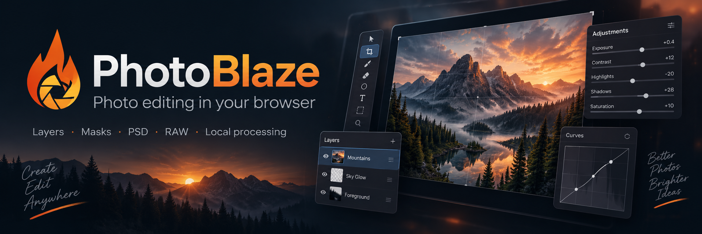

# Welcome to PhotoBlaze Requests! 👋

Thank you for your interest in **PhotoBlaze**! Whether you have an idea for a new tool, a small improvement that would make editing easier, or a bug to report, I’m glad you’re here. Your feedback helps make PhotoBlaze better for everyone.

This is the community home for **enhancement requests and bug reports** for [PhotoBlaze](https://photo-blaze.com/), a photo editor that runs in your browser. You don’t need to be a developer to contribute—just tell us about your experience in your own words.

[Open PhotoBlaze](https://photo-blaze.com/editor/) · [Read the user guide](https://photo-blaze.com/help/) · [Browse existing requests](https://github.com/JeremyDemers/PhotoBlaze-Requests/issues)

## 💡 Have an idea?

[Suggest an enhancement](https://github.com/JeremyDemers/PhotoBlaze-Requests/issues/new?title=Enhancement%3A%20) and tell us:

- What you’d like to do and what gets in your way today.
- How you imagine the improvement working.
- An example or screenshot, if it helps explain your idea.

Big ideas and small quality-of-life improvements are both welcome. A description of the problem you’re trying to solve is just as valuable as a proposed solution!

## 🐛 Found a bug?

[Report a bug](https://github.com/JeremyDemers/PhotoBlaze-Requests/issues/new?title=Bug%3A%20) and include whatever you can:

- **Steps to reproduce:** what you clicked or did, in order.
- **Expected result:** what you thought would happen.
- **Actual result:** what happened instead, including any error message.
- **Your setup:** browser and version, operating system, and file type. Image dimensions and color depth can also help with file or editing problems.
- **A screenshot or small sample file:** helpful when the problem is visual or file-specific.

Don’t worry if you don’t have every detail. Start with what you know, and we can work from there. Reports and attachments here are public, so please use a sample you’re comfortable sharing and leave out personal or confidential information.

## Before you post

Take a quick look through [existing issues](https://github.com/JeremyDemers/PhotoBlaze-Requests/issues?q=is%3Aissue) to see whether someone has already shared the same idea or problem. If so, add a 👍 reaction or a comment with useful details. Otherwise, open a new issue with a descriptive title, and keep each issue focused on one request or bug.

You’ll need a GitHub account to create or comment on an issue. Please keep conversations kind and constructive—we’re all here to make editing better.

## Thanks for helping PhotoBlaze grow ❤️

PhotoBlaze is still evolving, and your feedback helps guide what comes next. A request isn’t a promise of a particular feature or release date, but the time you take to share your experience is appreciated.

Thank you for trying PhotoBlaze, reporting rough edges, and sharing your ideas!

— **Jeremy Demers**, creator of PhotoBlaze
